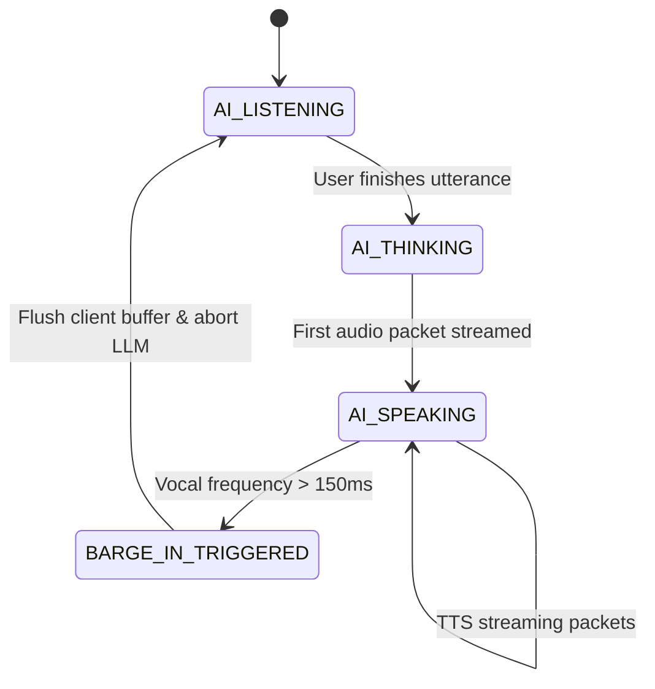

# Real-Time Conversational Voice AI Agent Architecture

This skill provides the production architecture, latency budgets, and interruption protocols required to build human-like conversational Voice AI agents operating under **300ms total response latency**.

---

## 1. The Core Latency Problem: Sequential Bottleneck

Naive voice implementations execute in a blocking sequence:
```
[User Mic] ➔ [STT API Call (1.2s)] ➔ [LLM Generation (1.8s)] ➔ [TTS API Call (1.0s)] ➔ [Audio Output]
Total Latency: 4.0+ seconds (Awkward, unnatural silence)
```
Increasing server CPU or switching to a smaller LLM fails to solve this because the **sequential blocking pipeline itself is the bottleneck**.

---

## 2. Production Two-Layer Architecture

### Layer 1: Full-Duplex WebRTC + Token-Streaming TTS (<300ms)

Never wait for the full response paragraph before synthesizing voice:

1. **Full-Duplex WebRTC Transport:**
   - Establish bidirectional WebRTC audio tracks between client and edge gateway.
   - Use low-overhead Opus audio encoding (16kHz or 24kHz mono, 20ms frames).
2. **Streaming Speech-to-Text (STT):**
   - Continuously stream raw audio chunks via WebSocket/WebRTC to a streaming STT engine (e.g. Deepgram Nova-2, Whisper Live).
   - Consume interim transcription events with sub-100ms partial transcripts.
3. **Pipelined Token Dispatch:**
   - As tokens stream from the LLM, buffer only the **first 3–4 tokens** (e.g., `["Hello!", " How", " can", " I"]`).
   - Immediately dispatch these first tokens to a streaming TTS engine (e.g. Cartesia Sonic, ElevenLabs Flash, PlayHT Turbo).
4. **Immediate First-Audio Playback:**
   - Client starts playing audio packet at **$T \approx 280\text{ms}$** while the LLM continues generating subsequent sentence tokens in the background.

```
Sequential Pipeline:
[  STT 1.2s  ][      LLM 1.8s      ][  TTS 1.0s  ] ▶ Audio (4.0s)

Streaming Pipeline:
[ STT 120ms ]
   └▶ [ LLM 1st 4 tokens 90ms ]
         └▶ [ TTS First Chunk 70ms ] ▶ Audio starts at 280ms!
```

---

## 3. Layer 2: Barge-In Interruption Engine & Buffer Flush

Without intelligent barge-in, background street noise or coughs cause false interruptions, and legitimate human speech causes the AI to speak over the user.

### State Machine & Interruption Flow



### 4-Stage Interruption Pipeline:

1. **Neural Noise Suppression:**
   - Filter vehicular noise, typing, air conditioning, and room reverberation using RNNoise or DeepFilterNet before speech detection.
2. **Silero VAD (Voice Activity Detection):**
   - Evaluate speech probability every 30ms window.
   - **Threshold Guard:** Vocal frequencies must exceed confidence threshold ($P > 0.75$) continuously for **$\ge 150\text{ms}$** to confirm deliberate speech.
   - Ignores momentary spikes, short coughs (<100ms), and background laughter.
3. **Barge-In Controller Event (`Interrupt_Signal`):**
   - When verified, immediately broadcast an interruption event down the WebRTC data channel.
4. **Client Audio Buffer Flush & LLM Abort:**
   - **Client-Side:** Immediately drop and zero-out all unplayed queued audio frames in the web/mobile audio output buffer (prevents trailing speech).
   - **Server-Side:** Abort LLM stream generation (`AbortController.abort()`) to stop consuming tokens and save inference costs.
   - Transition agent status immediately back to `AI: LISTENING`.

---

## 4. Implementation Reference (Node.js / TypeScript Orchestrator)

```typescript
import { EventEmitter } from 'events';

interface VoiceSessionConfig {
  sampleRate: number;
  vadThresholdMs: number;
}

export class VoiceAgentOrchestrator extends EventEmitter {
  private isSpeaking = false;
  private vadSpeechAccumulatorMs = 0;
  private llmAbortController: AbortController | null = null;

  constructor(private config: VoiceSessionConfig = { sampleRate: 16000, vadThresholdMs: 150 }) {
    super();
  }

  // Handle incoming raw audio frames from WebRTC
  public handleAudioChunk(pcmChunk: Int16Array, isSpeech: boolean, frameDurationMs: number): void {
    if (isSpeech) {
      this.vadSpeechAccumulatorMs += frameDurationMs;

      // Human intent verified: vocal energy sustained > 150ms
      if (this.isSpeaking && this.vadSpeechAccumulatorMs >= this.config.vadThresholdMs) {
        this.executeBargeIn();
      }
    } else {
      this.vadSpeechAccumulatorMs = 0;
    }
  }

  // Immediate interruption execution
  public executeBargeIn(): void {
    console.log('[VoiceAgent] Barge-in triggered. Flushing buffers & halting LLM.');
    
    // 1. Abort ongoing LLM inference
    if (this.llmAbortController) {
      this.llmAbortController.abort();
      this.llmAbortController = null;
    }

    // 2. Notify client to drop queued audio playback
    this.emit('client_control', { action: 'FLUSH_AUDIO_BUFFER' });

    // 3. Reset internal state
    this.isSpeaking = false;
    this.vadSpeechAccumulatorMs = 0;
    this.emit('state_change', 'LISTENING');
  }

  // Token-level streaming playback trigger
  public async streamLLMResponse(tokenStream: AsyncIterable<string>): Promise<void> {
    this.llmAbortController = new AbortController();
    this.isSpeaking = true;
    this.emit('state_change', 'SPEAKING');

    let tokenBuffer = '';
    let initialChunkSent = false;

    for await (const token of tokenStream) {
      if (this.llmAbortController.signal.aborted) break;

      tokenBuffer += token;
      
      // Dispatch early on first 3-4 words or sentence clause
      if (!initialChunkSent && tokenBuffer.split(' ').length >= 4) {
        this.emit('tts_synthesize', { text: tokenBuffer, isPriority: true });
        tokenBuffer = '';
        initialChunkSent = true;
      }
    }

    if (tokenBuffer.trim() && !this.llmAbortController.signal.aborted) {
      this.emit('tts_synthesize', { text: tokenBuffer, isPriority: false });
    }
  }
}
```

---

## 5. Pre-Flight Checklist for Voice Agents

- [ ] **Full-Duplex Audio:** WebRTC data and media channels are active simultaneously.
- [ ] **Token Chunking:** TTS initiates after first 3–4 tokens ($<300\text{ms}$ Time-to-First-Audio).
- [ ] **VAD Calibration:** 150ms minimum speech threshold to avoid false interruptions.
- [ ] **Client Buffer Dropping:** Audio context output buffer cancels immediately on interrupt packet.
- [ ] **Inference Cancellation:** Server-side `AbortController` terminates LLM stream on barge-in.
- [ ] **Echo Cancellation:** Hardware/browser Acoustic Echo Cancellation (`echoCancellation: true`) enabled on microphone stream.
